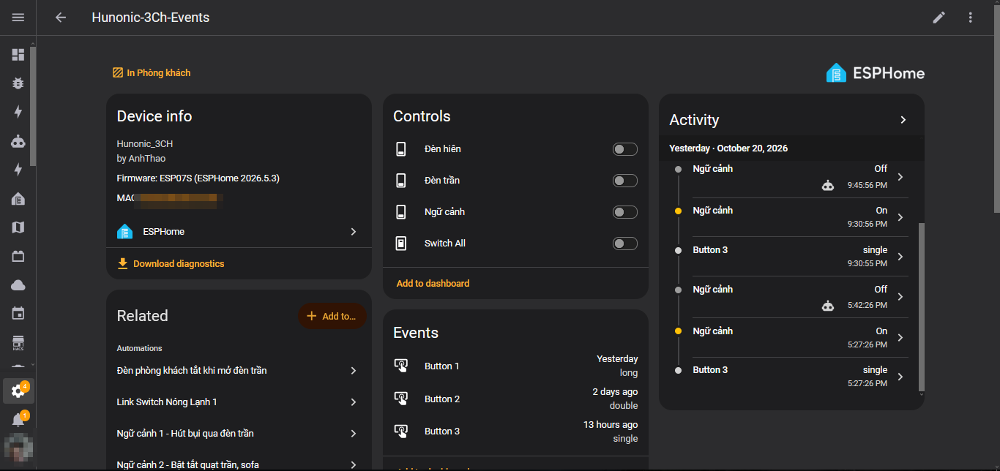
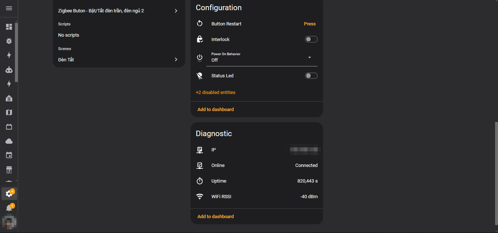

<div align="center">

# 🔌 Hunonic 3CH — ESPHome Firmware

**Firmware [ESPHome](https://esphome.io) cho công tắc cảm ứng Hunonic 3 kênh dùng chip ESP-07S (ESP8266)**
*Khóa liên động (Interlock) tùy chọn • Nhớ trạng thái khi mất điện • Nhấn giữ nút chạy ngữ cảnh • Tích hợp Home Assistant*

[](https://esphome.io)
[](https://www.espressif.com)
[](https://www.home-assistant.io)
[](LICENSE)
[](https://github.com/anhthao8x/hunonic-3ch-esphome/stargazers)

</div>

---

## 📑 Mục lục

- [📸 Hình ảnh thực tế](#-hình-ảnh-thực-tế-trên-home-assistant)
- [✨ Tính năng](#-tính-năng)
- [🔌 Phần cứng & sơ đồ chân](#-phần-cứng--sơ-đồ-chân-gpio)
- [🚀 Cài đặt](#-cài-đặt)
- [🏠 Tích hợp Home Assistant](#-tích-hợp-home-assistant)
- [🎛️ Sử dụng](#️-sử-dụng)
- [🛠️ Xử lý sự cố](#️-xử-lý-sự-cố)
- [📁 Cấu trúc dự án](#-cấu-trúc-dự-án)

---

## 📸 Hình ảnh thực tế trên Home Assistant

Trang thiết bị — 3 kênh điều khiển, sự kiện nhấn nút (single / double / long) và nhật ký hoạt động:



Mục cấu hình (Interlock, Power On Behavior) và chẩn đoán (trạng thái kết nối, uptime, Wi-Fi RSSI):



---

## ✨ Tính năng

| Tính năng | Mô tả |
|---|---|
| **3 kênh điều khiển** | Bật/tắt độc lập 3 tải (đèn/relay), điều khiển tại chỗ bằng cảm ứng hoặc từ xa qua Home Assistant |
| **Interlock (khóa liên động)** | Khi bật: bật 1 kênh sẽ tự động tắt 2 kênh còn lại (phù hợp quạt nhiều số, rèm cửa lên/xuống...). Mặc định **tắt**, bật/tắt được từ Home Assistant |
| **Power On Behavior** | Chọn hành vi sau khi có điện lại: `On` (bật hết) / `Off` (tắt hết) / `Last_State` (khôi phục trạng thái trước khi mất điện) |
| **Nhấn giữ kích hoạt scene** | Giữ nút ≥ 800ms → phát sinh binary sensor `Button X Hold` để chạy automation/scene trong Home Assistant. Nhấn thường (< 700ms) vẫn là bật/tắt |
| **Chống rung & chống lỗi khi boot** | Debounce 50ms cho chip cảm ứng TS04, khóa thao tác nút cho đến khi boot hoàn tất, tránh bật/tắt nhầm lúc khởi động |
| **Wi-Fi dự phòng** | Không kết nối được Wi-Fi nhà → thiết bị tự phát hotspot `hunonic-3ch-interlock-xxxx` (captive portal) để cấu hình lại |
| **Cập nhật OTA** | Nạp firmware qua Wi-Fi có mật khẩu bảo vệ; API kết nối Home Assistant được mã hóa |
| **Giám sát** | Cảm biến uptime, cường độ sóng Wi-Fi (RSSI), địa chỉ IP; nút Restart / Safe Mode / Factory Reset từ giao diện |

---

## 🔌 Phần cứng & sơ đồ chân (GPIO)

**Bo mạch:** ESP-07S (tương thích ESP-12F / ESP-12E), CPU chạy ở 160MHz.
**Chip cảm ứng:** ADS TS04 — ngõ ra open-drain, mức **LOW khi chạm**, cần điện trở pull-up (đã bật pull-up nội trong cấu hình).

| Chức năng | GPIO | Ghi chú |
|:---|:---:|:---|
| LED / Relay kênh 1 | GPIO14 | |
| LED / Relay kênh 2 | GPIO12 | |
| LED / Relay kênh 3 | GPIO13 | |
| LED trạng thái (Status LED) | GPIO16 | Mức tích cực **đảo** (inverted) |
| Nút cảm ứng 1 (TS04 OUT1) | GPIO5 | Kéo lên (pull-up), đảo mức |
| Nút cảm ứng 2 (TS04 OUT2) | GPIO4 | Kéo lên (pull-up), đảo mức |
| Nút cảm ứng 3 (TS04 OUT3) | GPIO0 | ⚠️ Xem lưu ý bên dưới |

> [!WARNING]
> **GPIO0 là chân strapping:** nếu bị kéo xuống LOW lúc cấp nguồn, ESP8266 sẽ vào chế độ nạp Flash thay vì chạy chương trình. Cấu hình đã có `delayed_on: 50ms` và cờ `boot_done` để chống trường hợp TS04 xuất mức LOW thoáng qua khi khởi động, nhưng khi sửa phần cứng cần đặc biệt chú ý kênh 3.

> [!CAUTION]
> **An toàn điện:** Công tắc làm việc với điện lưới 220V. Chỉ thao tác phần cứng khi đã ngắt nguồn hoàn toàn. Firmware này được cung cấp "nguyên trạng" — người dùng tự chịu trách nhiệm khi sử dụng với thiết bị thực tế.

Một số lưu ý kỹ thuật đã được xử lý sẵn trong cấu hình:

- `early_pin_init: false` — tránh relay/LED chớp (glitch) khi boot.
- `restore_from_flash: true` + `flash_write_interval: 60s` — lưu trạng thái vào Flash, nhớ được sau khi rút điện, đồng thời hạn chế ghi Flash liên tục gây mòn.
- LED trạng thái **nháy 3 lần** khi khởi động xong — dấu hiệu nhận biết thiết bị đã sẵn sàng.

---

## 🚀 Cài đặt

### 1. Yêu cầu

- Đã cài **ESPHome** (khuyên dùng ESPHome Add-on trong Home Assistant, hoặc bản CLI/Dashboard độc lập).
- Máy tính cùng mạng LAN với thiết bị (cho lần nạp OTA), hoặc cáp USB-Serial (UART) cho lần nạp đầu tiên.

### 2. Chuẩn bị file cấu hình

Clone repo này về thư mục cấu hình ESPHome của bạn:

```bash
git clone https://github.com/anhthao8x/hunonic-3ch-esphome.git
```

Tạo file `secrets.yaml` từ file mẫu và điền thông tin của bạn:

```bash
cp secrets.yaml.example secrets.yaml
```

```yaml
wifi_ssid: "TenWiFiNhaBan"
wifi_password: "MatKhauWiFi"
ap_password: "MatKhauChoHotspotDuPhong"     # ≥ 8 ký tự
api_encryption_key: "<key-base64-32-byte>"  # xem cách tạo bên dưới
ota_password: "MatKhauCapNhatOTA"
```

Tạo `api_encryption_key` bằng lệnh:

```bash
openssl rand -base64 32
```

> [!IMPORTANT]
> **Tuyệt đối không commit file `secrets.yaml` lên Git** — file này đã nằm trong `.gitignore`. Chỉ commit `secrets.yaml.example` (không chứa giá trị thật).

### 3. Kiểm tra & biên dịch

```bash
esphome config Hunonic_3K.yaml   # kiểm tra cú pháp
esphome run Hunonic_3K.yaml      # biên dịch + nạp + xem log
```

- **Lần nạp đầu tiên:** chọn cổng Serial (USB-UART). Cần đưa ESP8266 vào chế độ nạp: kéo GPIO0 xuống GND khi cấp nguồn.
- **Các lần sau:** chọn thiết bị qua mạng (OTA), nhập `ota_password` khi được hỏi.

Tên thiết bị mặc định là `hunonic-3ch-interlock` kèm hậu tố MAC (ví dụ `hunonic-3ch-interlock-a1b2c3`). Muốn đổi tên, sửa biến `devicename` ở đầu file `Hunonic_3K.yaml`.

---

## 🏠 Tích hợp Home Assistant

1. Mở **Settings → Devices & Services → Add Integration → ESPHome**.
2. Nhập địa chỉ IP của thiết bị (xem entity `IP` hoặc log ESPHome) và **Noise encryption key** chính là `api_encryption_key` trong `secrets.yaml`.
3. Sau khi thêm, bạn sẽ thấy các entity:

| Entity | Loại | Mô tả |
|:---|:---:|:---|
| `Switch 1 / 2 / 3` | switch | Điều khiển từng kênh |
| `Switch All` | switch | Bật/tắt cả 3 kênh cùng lúc |
| `Interlock` | switch (config) | Bật/tắt chế độ khóa liên động |
| `Power On Behavior` | select (config) | `On` / `Off` / `Last_State` |
| `Button 1 / 2 / 3 Hold` | binary sensor | ON khi đang giữ nút ≥ 800ms, OFF khi nhả |
| `Online` | binary sensor | Trạng thái kết nối |
| `Status LED` | light (config) | LED trạng thái trên thiết bị |
| `Uptime`, `WiFi RSSI`, `IP` | sensor / text sensor | Thông tin giám sát |
| `Button Restart`, `Safe Mode`, `Factory Default` | button | Khởi động lại / chế độ an toàn / khôi phục mặc định (2 nút sau mặc định bị ẩn) |

---

## 🎛️ Sử dụng

### Chế độ Interlock

Bật entity **Interlock** khi bạn muốn tại một thời điểm chỉ có tối đa 1 kênh bật — ví dụ 3 tốc độ quạt dùng chung 1 mô-tơ, hoặc điều khiển rèm. Tắt Interlock để 3 kênh hoạt động độc lập như công tắc thường.

### Hành vi khi có điện lại (Power On Behavior)

Chọn trong entity **Power On Behavior**:

- **On** — bật cả 3 kênh (hữu ích cho đèn cần sáng ngay khi có điện).
- **Off** — giữ tắt cả 3 kênh (an toàn, mặc định).
- **Last_State** — khôi phục đúng trạng thái từng kênh trước khi mất điện.

### Nhấn giữ nút để chạy scene

Giữ bất kỳ nút cảm ứng nào ≥ 800ms: LED trạng thái nháy xác nhận, binary sensor `Button X Hold` chuyển ON cho tới khi nhả tay. Trong Home Assistant, tạo Automation với trigger là binary sensor này để bật/tắt scene, nhóm đèn khác, v.v. — một nút vật lý đảm nhiệm 2 chức năng.

---

## 🛠️ Xử lý sự cố

| Hiện tượng | Nguyên nhân / cách xử lý |
|:---|:---|
| Nạp lần đầu không vào được chế độ boot | Kiểm tra GPIO0 đã kéo xuống GND **trước** khi cấp nguồn; kiểm tra đấu nối TX/RX chéo nhau |
| Thiết bị tự phát Wi-Fi `hunonic-3ch-interlock-xxxx` | Không kết nối được Wi-Fi nhà — kết nối vào hotspot này, captive portal sẽ mở để nhập lại Wi-Fi |
| Nút cảm ứng tự kích hoạt / nhạy quá mức | Kiểm tra nguồn cấp cho TS04, nối đất, và khoảng cách dây tín hiệu; cấu hình đã debounce 50ms — tránh giảm giá trị này |
| Home Assistant báo lỗi encryption key | Key trong `secrets.yaml` và key nhập vào integration phải giống hệt nhau; nếu đổi key cần nạp lại firmware |
| Sau khi mất điện trạng thái không đúng | Kiểm tra `Power On Behavior` đang chọn `Last_State`; trạng thái chỉ được ghi sau khi boot hoàn tất khoảng 60s (theo chu kỳ ghi Flash) |
| Quên mật khẩu OTA | Nạp lại bằng cáp Serial như lần đầu |

---

## 📁 Cấu trúc dự án

```
.
├── Hunonic_3K.yaml       # File cấu hình ESPHome chính
├── secrets.yaml.example  # Mẫu file secrets (không chứa thông tin thật)
├── secrets.yaml          # Thông tin nhạy cảm của bạn — KHÔNG commit (đã có trong .gitignore)
├── docs/images/          # Ảnh chụp thực tế trên Home Assistant (đã làm mờ thông tin riêng tư)
└── README.md             # Tài liệu này
```

## 📄 Giấy phép

Phát hành theo giấy phép MIT — tự do sử dụng, chỉnh sửa cho nhu cầu cá nhân và thương mại.

---

<div align="center">

*Được xây dựng với ❤️ trên nền tảng ESPHome + Home Assistant*

</div>
